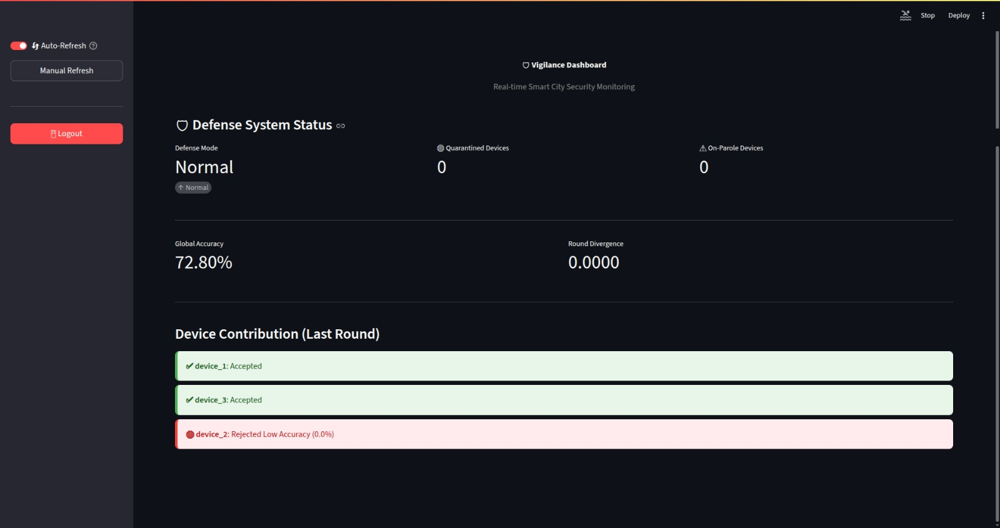
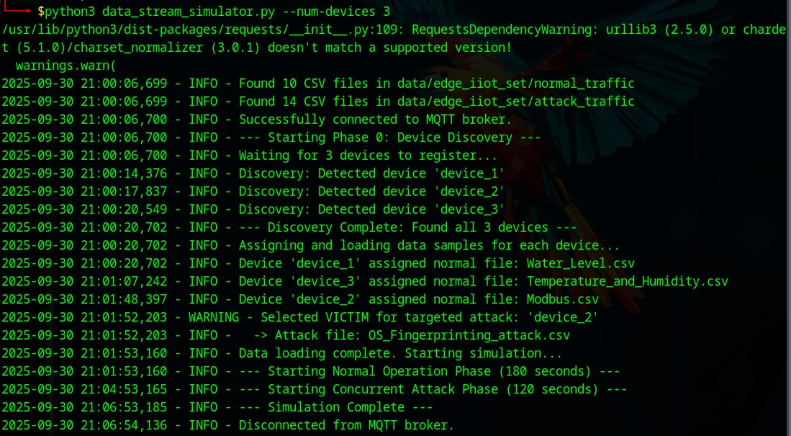
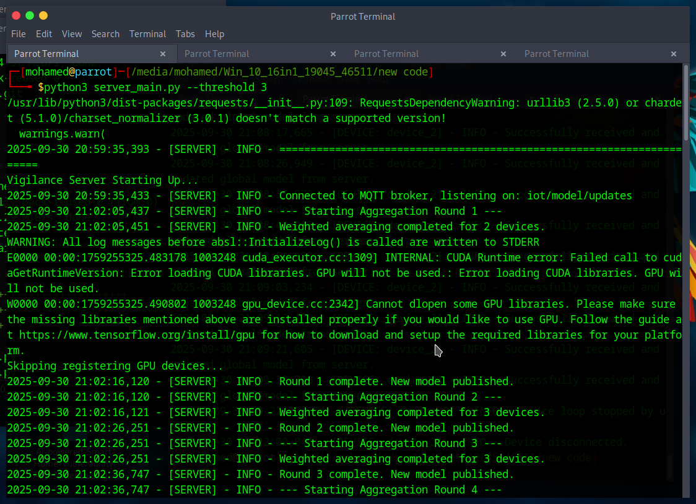
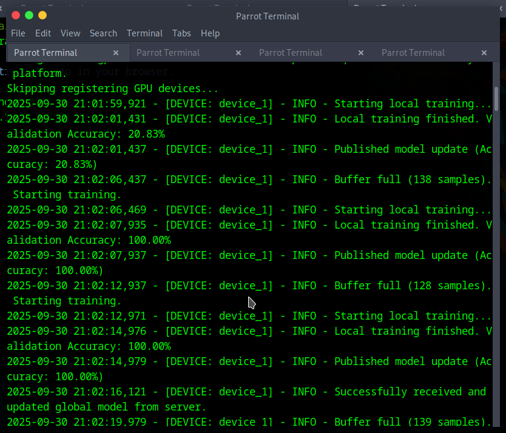
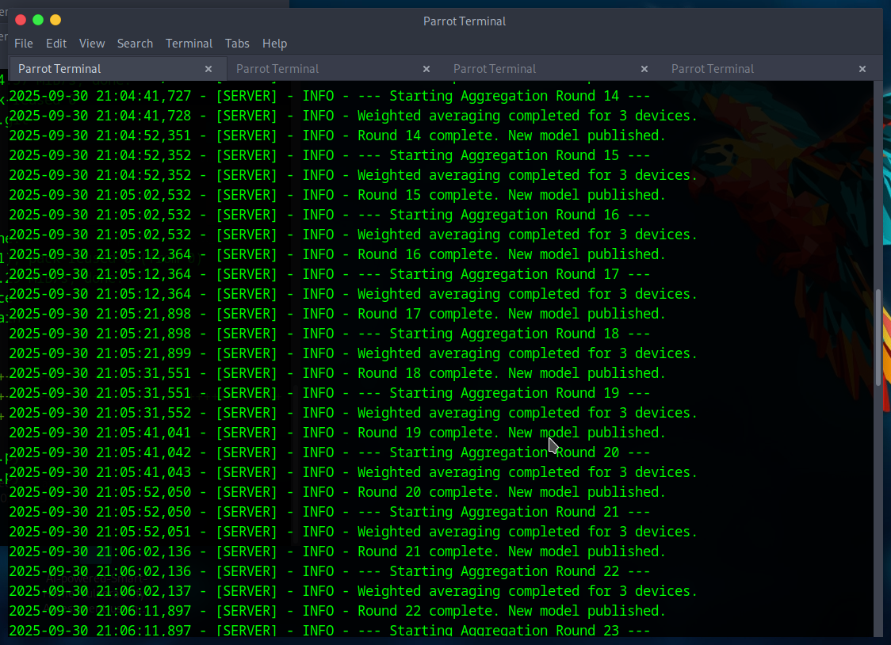

# 🛡️ Vigilance: A Privacy-Preserving Security Framework for Smart Cities

Vigilance is a sophisticated cybersecurity framework designed to act as a proactive "immune system" for smart cities. It leverages **Federated Learning (FL)** to detect and neutralize cyber threats against critical IoT infrastructure—such as traffic signals, power grids, and surveillance cameras—without ever centralizing sensitive user data.

This project was developed for the **Digitopia 2025** competition under the "Integrated Security Frameworks for Smart Cities" sub-challenge.

## ✨ Key Innovations & Features

  * **Privacy-by-Design Architecture**: At its core, Vigilance uses Federated Learning to train models directly on edge devices. Raw operational and personal data **never leaves the device**, ensuring compliance with modern privacy regulations by design.
  * **Advanced Weight-Centric Defense**: Instead of relying on potentially misleading accuracy metrics, the system's server analyzes the mathematical "behavior" of incoming model weights. It uses advanced metrics like **Model Divergence** to detect coordinated attacks and statistical **Norms** to pinpoint individual bad actors.
  * **Intelligent & Resilient Server**: The server features an advanced defense system with:
      * A **Grace Period** to prevent false alarms during initial system startup.
      * A **Quarantine & Parole System** that isolates identified malicious devices and treats them with suspicion even after they are released, preventing repeat offenses.
  * **Client-Side Self-Detection**: IoT device clients are smart enough to detect when their own data has been poisoned. If a device receives a high percentage of attack data, it will automatically report a catastrophic failure (`0.0%` accuracy) to the server, ensuring its immediate isolation.
  * **Real-time Operator Dashboard**: A professional web dashboard, built with Streamlit, provides a live, at-a-glance overview of the system's security posture, including the current defense mode, global model accuracy, and the status of all connected devices.

## 📸 Screenshots

**Operator dashboard.** Defense mode, global accuracy, round divergence, and the per-device verdict for the last round. Here `device_2` was fed attack traffic and its update was rejected.



**Data and attack simulator.** Discovers the three devices, assigns each a sensor stream, then picks a victim and runs the attack phase.



<details>
<summary>More: server and device logs</summary>





</details>

## 🚀 Getting Started

Follow these steps to set up and run the Vigilance simulation environment on your local machine.

### Prerequisites

  * Python 3.10+
  * An MQTT Broker (like Mosquitto) installed and running.
  * The required Python libraries.

### 1\. Clone the Repository

```bash
git clone https://github.com/Mohamed8221/Vigilance.git
cd Vigilance
```

### 2\. Install Dependencies

Install all necessary Python libraries using the `requirements.txt` file.

```bash
pip install -r requirements.txt
```

### 3\. Prepare the Dataset

Before running the system for the first time, you must run the setup script to create the global test set and master feature list.

The simulation uses the [Edge-IIoTset](https://www.kaggle.com/datasets/mohamedamineferrag/edgeiiotset-cyber-security-dataset-of-iot-iiot) dataset, which is not included in this repository. Download it and place it at the repository root so the layout is:

```
data/edge_iiot_set/
├── Selected dataset for ML and DL/DNN-EdgeIIoT-dataset.csv
├── normal_traffic/      # per-sensor CSV files
└── attack_traffic/      # per-attack CSV files
```

All commands below are run from the repository root.

```bash
python src/prepare_global_test_set.py
```

### 4\. Run the Simulation

The system consists of four main components that must be run simultaneously, each in its own terminal window.

  * **Terminal 1: Start the MQTT Broker**

    ```bash
    # (Ensure your MQTT broker is running on localhost:1883)
    mosquitto -c config/mosquitto.conf
    ```

    The provided config also opens a TLS listener on port 8883 that expects certificates in `certs/`. For a local run without certificates, comment out that listener block.

  * **Terminal 2: Start the Vigilance Server**
    The server is the central brain. The `--threshold` argument sets how many device updates it waits for before starting an aggregation round.

    ```bash
    python src/server_main.py --threshold 3
    ```

  * **Terminal 3 (and 4, 5...): Start the IoT Device Clients**
    Launch a separate client for each simulated device, giving each a unique `--id`.

    ```bash
    python src/federated_learning_loop.py --id device_1
    python src/federated_learning_loop.py --id device_2
    python src/federated_learning_loop.py --id device_3
    ```

  * **Terminal 6: Start the Data & Attack Simulator**
    This script will discover the running clients and begin streaming data to them. The `--num-devices` argument must match the number of clients you started.

    ```bash
    python src/data_stream_simulator.py --num-devices 3
    ```

  * **Terminal 7: Launch the Dashboard**
    Start the Streamlit web application to monitor the system in real-time.

    ```bash
    streamlit run src/vulnerability_report_review.py
    ```

    Now, open your web browser and navigate to `http://localhost:8501`.

## 🏛️ System Architecture

The Vigilance framework is built on a robust, decoupled architecture where components communicate securely and efficiently via an MQTT broker.

1.  **Data Stream Simulator**: Simulates a smart city environment, distributing normal and malicious data to clients.
2.  **Federated Learning Clients**: Represent individual IoT devices. They train local models and report their findings (weights) without exposing raw data.
3.  **Aggregation Server**: The central headquarters that collects weights, runs the advanced defense algorithms to filter out threats, aggregates the trusted updates, and distributes the improved global model.
4.  **Vulnerability Dashboard**: The command center for human operators, providing real-time visibility into the system's health and security status.


## 📈 Competition Alignment & Impact

This project directly aligns with the Digitopia competition criteria:

  * **AI Innovation (15%)**: Employs a sophisticated, weight-centric Federated Learning approach with advanced defenses like Divergence Analysis and a Quarantine system.
  * **Social Impact (25%)**: Directly enhances public safety by securing critical city infrastructure against cyberattacks that could cause traffic chaos, power outages, or surveillance failures.
  * **User-Centric Design (15%)**: Features a clean, real-time dashboard designed for operators, providing clear, actionable insights into the system's status.
  * **Professional Execution (15%) & Attractive Presentation (5%)**: The code is modular, well-documented, and the final dashboard is professionally designed for a polished user experience.

## 🤝 Acknowledgments

This project was developed by **Team Helios** under the guidance of **Dr. Mahmoud Atallah** for the Digitopia 2025 competition, representing the **Arab Open University, Egypt Branch**.
